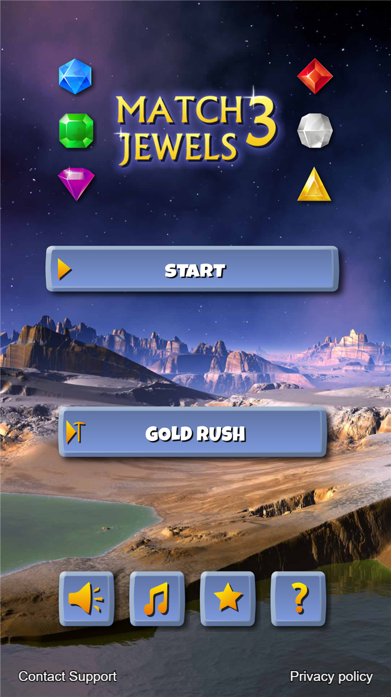
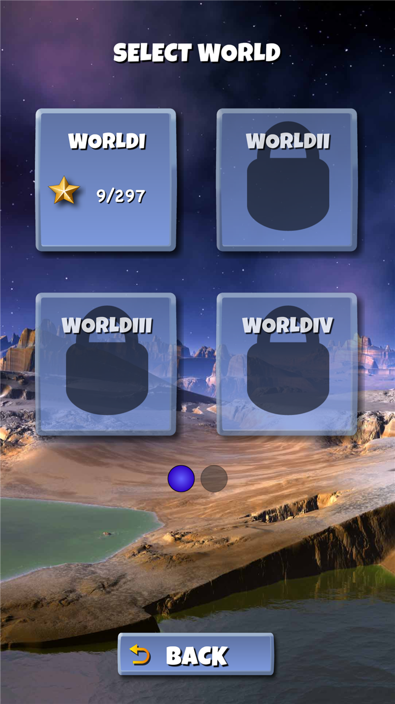
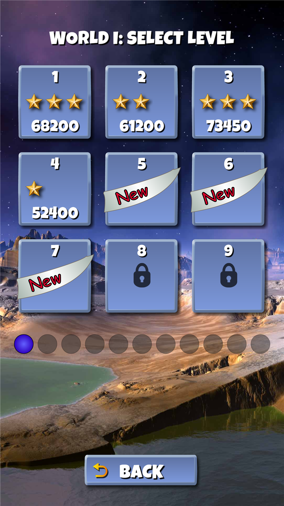
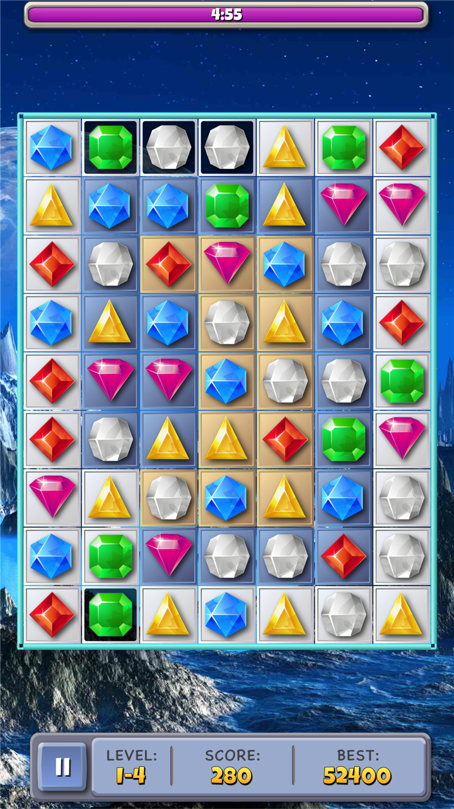
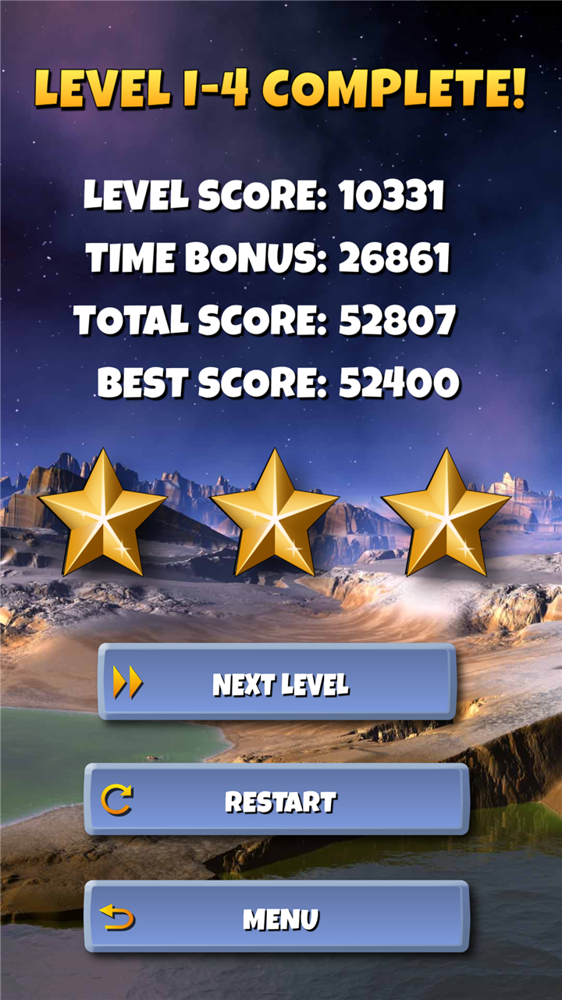
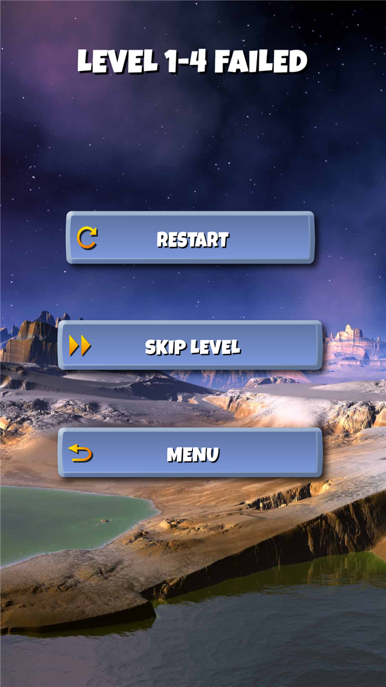

# 🍬 MATCH 3 JEWELS — Cocos Creator 2.4.2 三消游戏

基于 **Cocos Creator 2.4.2** 的完整三消游戏。26 个 JavaScript 脚本、约 4100 行代码、6 个场景、8 个世界 × 99 关，纯 Canvas 2D + `cc.tween` 实现。MVC 分层 + 事件总线架构，覆盖关卡地图、炸弹连锁、GoalGem、连击计分、洗牌提示、暂停重开、胜负结算、BGM 循环与桌宠式调试按钮。

---

## 📸 游戏截图

<table>
  <tr>
    <td align="center" width="50%">
      <b>🏠 开始界面</b><br>
      
    </td>
    <td align="center" width="50%">
      <b>🌍 世界选择</b><br>
      
    </td>
  </tr>
  <tr>
    <td align="center" width="50%">
      <b>🗺️ 关卡选择</b><br>
      
    </td>
    <td align="center" width="50%">
      <b>🎮 游戏主界面</b><br>
      
    </td>
  </tr>
  <tr>
    <td align="center" width="50%">
      <b>🏆 胜利结算</b><br>
      
    </td>
    <td align="center" width="50%">
      <b>💥 失败结算</b><br>
      
    </td>
  </tr>
</table>

---

## 🎯 游戏流程

```
StartScene          LevelSelectScene        WaveSelectScene        BestGameScene
开始界面     →      世界选择（8 个 WORLD）→  关卡选择（每世界 99 关）→  三消主场景
标题 / 开始          每页 4 个世界框          每页 9 个关卡            7×9 棋盘 + 计时计分
声音 / 音乐开关      分页球翻页               已通关 / 新关 / 锁        暂停面板 + 提示 + 洗牌
                                                                          ↓
                                                              WinScene ←→ DefeatScene
                                                              胜利结算      失败结算
```

场景切换使用「页面列车」式滑动：新页面从右侧滑入（0.27 秒），旧页面同时滑出，无黑屏跳转。

---

## 🧩 核心机制

### 棋盘与关卡地图（`BestGameModel` · `LevelData`）

- 7 列 × 9 行，格子边长 92.43，6 种宝石：蓝 / 绿 / 紫 / 红 / 白 / 黄
- 每个格子有 3 级背景，被消除时逐级降级（3 → 2 → 1 → 0），0 级后格子消失
- 地图用 9 行字符串描述，`1/2/3` 表示背景层数，`-` 表示空洞：

```
"1111111"
"1222221"
"1233321"
"12---21"
"1233321"
```

- 第 1~6 关为手工地图（全盘、方框、腰带、宝石菱形、空洞环、中空十字）
- 第 7~99 关按关卡号程序生成：镜像 / 四向对称的「轨道」随机挖空，最多 16 个洞；再用 LCG 伪随机保证同一关每次生成完全一致
- `canPlay` 校验每个格子至少能组成一次三连，避免生成死图；三层背景概率随关卡递增（约 8% → 35%）

### 消除与炸弹

- 拖动交换相邻宝石，交换后不成立会原路滑回；空洞与 GoalGem 不可交换
- 任意方向三连及以上即消除，一次交换可能同时产生多组
- 单组达到 4 颗时在组内生成**炸弹**：炸弹下次被消除时炸掉周围 3×3，被波及的炸弹继续引爆，形成连锁
- GoalGem 免疫爆炸，不会被炸掉
- 引擎会把每一次消除、爆炸、下落记录成 `steps`，View 按顺序回放，动画与数据严格同步

### 计分与连击

| 项目 | 规则 |
|------|------|
| 单颗分值 | `10 × (comboCount + 本波组数 - 1)` |
| 连锁奖励 | 同一波连锁第 2 层起：`100 × (波次 - 1) × 组数` |
| 连击窗口 | 两次消除间隔 ≤ 3 秒，连击数持续累加；超时清零 |
| 时间奖励 | `floor(剩余秒数) × 300` |
| 星级 | 总分 ≥ 90000 三星，≥ 60000 两星，其余一星 |

消除时每颗宝石的位置会飘出分值，连锁时顶部弹出连击奖励横幅。

### 胜利条件与 GoalGem

1. 棋盘上所有格子的背景都降到 0 级
2. 下一次消除时，GoalGem 跟随新宝石从顶部生成在「最后被消除的格子」所在列
3. GoalGem 一路下落，穿过该列最底部的格子即通关

GoalGem 首次登场有专属动画：两颗宝石从屏幕外滚入、围绕公共圆心旋转，再合体落到棋格上；落在棋盘后仍保持嵌套旋转。

### 提示、洗牌与开局

- 空闲 7 秒后自动提示一组可消除的交换，两颗棋子左右摆动
- 棋盘无解时先显示 `NO MOVES`，再显示 `REFRESHING`，随后重排棋子（颜色数量不变）并播放洗牌动画
- 非第一关开局若已存在三连，会先自动消除并结算，再开始计时
- 开局显示 `LEVEL I-4` 大字，1.4 秒后向左飞出屏幕

### 新手引导（三步）

| 步骤 | 弹窗 | 固定棋局 | 提示方式 |
|------|------|----------|----------|
| 1 | Tip1 | 绿 绿 黄 绿（第 2 行） | 手指在第 3、4 列之间循环拖动 |
| 2 | Tip2 | 紫 白 紫 紫（第 6~7 行） | 手指在第 6 行第 2、3 列之间拖动 |
| 3 | Tip3 | — | 胜利弹窗，点确认解锁并回到选关 |

两个操作教程共用同一张棋盘，切换时棋盘不动，只更换弹窗与手指；手指动画为「去 → 回 → 停 0.4 秒」循环。

---

## ✨ 动画一览

| 动画 | 表现 |
|------|------|
| 交换 | 两颗宝石同时滑向对方坐标，0.2 秒 |
| 交换失败 | 同一函数再次调用，原路滑回 |
| 消除 | 缩放至 0 后销毁 |
| 下落 | 按距离 / 1024 计算时长，先落到目标位下方 21 像素，再用弹簧曲线回弹归位 |
| 新宝石入场 | 从棋盘上方按列排队落入 |
| 背景降级 | 左右压扁到 0，换图后展开，0.25 秒 |
| 炸弹引线 | 炸弹贴图上叠加火花，持续闪烁 |
| 爆炸 | 火光 + 冲击波：周围棋子先被推出，再弹回，同时内外圈棋子消失 |
| GoalGem 登场 | 双宝石滚入 + 公共圆心逆时针旋转 + 合体落格 |
| 连击横幅 | 连锁奖励从顶部弹出并淡出 |
| 分数飘字 | 每颗被消除宝石的位置显示 `+分值` 并上浮 |
| 洗牌 | 棋子缩小 → 打乱 → 重新落位 |
| 棋盘重开 | 整盘向下掉出屏幕，新棋盘从上方掉入 |
| 开局文字 | `LEVEL I-4` 停留 1.4 秒后向左飞出 |
| 提示 | 两颗候选棋子左右摆动 |
| 切页 | 新旧页面 0.27 秒横向滑动 |
| 结算 | 分数从初始值滚动计数，星星逐颗点亮 |
| 暂停 | 冻结棋盘节点动画、连锁调度与手指，同时停表 |

节点统一按 `gem_行_列` / `bg_lv_行_列` / `goal` / `border` 命名，动画全部按名字定位节点。

---

## 🗂️ 场景一览

| 场景 | 脚本 | 说明 |
|------|------|------|
| **StartScene** | StartController / StartView + BtnMove / BtnChange / DimondChange | 标题、开始按钮、声音 / 音乐开关，宝石浮动闪烁 |
| **LevelSelectScene** | LevelSelectController / LevelSelectView / LevelSelectModel | 8 个 WORLD（I~VIII），每页 4 个，分页球翻页，显示世界星数 |
| **WaveSelectScene** | WaveSelectController / WaveSelectView / WaveSelectModel | 每世界 99 关、每页 9 关，三种状态：已通关 / 新解锁 / 锁定 |
| **BestGameScene** | BestGameController / BestGameView / BestGameModel + GamePause | 三消主场景，含暂停面板（继续 / 重开 / 菜单） |
| **WinScene** | WinSceneController / WinSceneView / WinSceneModel | 胜利结算：关卡分、时间奖励、总分、最高分、星级、下一关 |
| **DefeatScene** | DefeatController / DefeatView / DefeatModel | 失败结算：重开 / 跳关 / 菜单，跳关仅在进度允许时出现 |

---

## 💾 存档设计

| 键 | 含义 |
|----|------|
| `best_世界_关卡` | 单关最高分 |
| `stars_世界_关卡` | 单关星级（0~3） |
| `completed_世界` | 该世界已通关的最高关 |
| `currentWorld` | 当前选择的世界 |
| `bgmOn` | BGM 开关（默认开） |

- 关卡解锁规则：已通关关数 + 3 以内的关卡可进入
- 世界星数 = 该世界 99 关的星级总和，上限 297
- BGM 由 `BGM.js` 管理，两首曲目循环播放，开关状态写入 `localStorage`

---

## 🛠️ 工程结构

```
assets/
├── Scences/                        6 个场景（.fire）
│   ├── StartScene
│   ├── LevelSelectScene
│   ├── WaveSelectScene
│   ├── BestGameScene
│   ├── WinScene
│   └── DefeatScene
├── Scripts/
│   ├── EventBus.js                 全局事件总线
│   ├── Page.js                     页面滑动基类
│   ├── BGM.js                      BGM 循环与开关
│   ├── StartScene/                 开始界面 MVC + 按钮动效
│   ├── LevelSelectScene/           世界选择 MVC
│   ├── WaveSelectScene/            关卡选择 MVC
│   ├── BestGameScene/
│   │   ├── BestGameController.js   输入、流程、计时、提示、洗牌
│   │   ├── BestGameModel.js        棋盘、匹配、炸弹、计分、GoalGem
│   │   ├── BestGameView.js         重绘、全部动画、多个特效
│   │   ├── LevelData.js            关卡时间与地图生成
│   │   └── GamePause.js            暂停面板
│   ├── WinScene/                   胜利结算 MVC
│   ├── DefeatScene/                失败结算 MVC
│   └── KaiGua/CheatButton.js       桌宠式调试按钮
└── resources/                      图片、字体、预制体
    ├── GameResources/Gem/          宝石、格子背景、边框、炸弹、GoalGem
    ├── LoginResources/             开始界面素材
    ├── ReadyResources/             世界选择素材
    ├── WaveResources/              关卡选择素材
    ├── YuZhijian/                  弹窗、页面、结算预制体
    └── ziti/                       位图字体 + TTF 字体
screenshot/                         运行截图
```

---

## 🐤 调试按钮（CheatButton）

暂停界面会弹出小黄人 / 小红人按钮，是可拖拽的桌宠式组件：

- 按住可拖动，松手按甩动速度飞出，带重力、撞墙反弹、旋转衰减、挤压回弹
- 点击有光环、粒子、飘字反馈，并在屏幕边界内随机出现
- 小黄人：加 10000 分；小红人：让 GoalGem 直接落到最底行
- 通过 `window.cheatAddScore` / `window.cheatDropGoal` 两个钩子和游戏通信，模块自身不依赖任何游戏脚本

---

## 🧰 技术栈

`Cocos Creator 2.4.2` · `JavaScript` · `Canvas 2D` · `MVC 分层` · `cc.tween 缓动` · `cc.Graphics 特效` · `localStorage 存档`

## ▶️ 运行

用 **Cocos Creator 2.4.2** 打开 `BestGameForever2` 目录，点击浏览器预览即可运行。设计分辨率 720 × 1280，竖屏。
