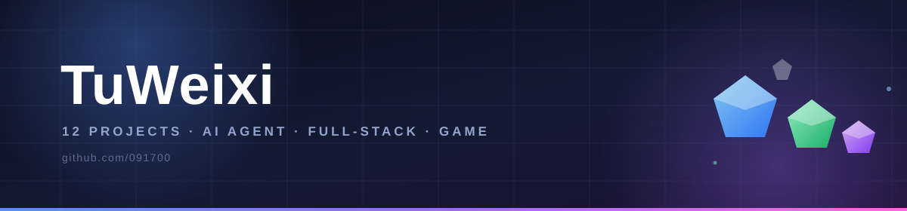



  
    
  
  
  
  
    
  12 个自研项目，覆盖 AI Agent、全栈 Web、桌面工具与游戏。 每个仓库都有独立 README，记录实现思路与关键取舍。

 

---

## 🤖 AI 与全栈

<table>
  <tr>
    <td width="24%" valign="top">
      <b>🗄️ sql_agent</b> 
      LLM Agent 全栈
    </td>
    <td valign="top">
      从零实现，1460 行自研代码，不套框架黑盒。
      <ul>
        <li>Agent Loop：五维终止 · LLM 自评 · Self-Healing 重试</li>
        <li>多 Agent 编排：DAG → Kahn 拓扑 → asyncio 并行</li>
        <li>PER 经验回放：按 TD-error 采样并注入 Prompt</li>
        <li>SQL 三层沙箱 · RBAC · 高危操作审批</li>
      </ul>
      
      
      
      
      
    </td>
  </tr>
</table>

<table>
  <tr>
    <td width="24%" valign="top">
      <b>🎙️ SmartInterview</b> 
      AI 模拟面试
    </td>
    <td valign="top">
      语音面试 + 声学评分 + 内容追问的一体化平台。
      <ul>
        <li>WebSocket 实时对话，服务端 353 行</li>
        <li>Faster-Whisper GPU 转写，librosa 三项声学指标</li>
        <li>紧张度 / 自信度 / 清晰度三维评分</li>
        <li>ChromaDB + bge-small-zh 知识库检索</li>
        <li>DeepSeek 内容评分与追问生成</li>
      </ul>
      
      
      
      
    </td>
  </tr>
</table>

<table>
  <tr>
    <td width="24%" valign="top">
      <b>🧊 SmartPantry</b> 
      智能冰箱管理
    </td>
    <td valign="top">
      预测保鲜期，顺便给黑暗料理打分。
      <ul>
        <li>PyTorch 全连接网络预测食材保鲜期</li>
        <li>5 维风味向量余弦相似度评分</li>
        <li>Qwen 2.5-1.5B 零样本提取食材特征</li>
        <li>19 种人工整理的风味特征基础库</li>
      </ul>
      
      
      
      
    </td>
  </tr>
</table>

<table>
  <tr>
    <td width="24%" valign="top">
      <b>📚 Book Platform</b> 
      智能图书交易
    </td>
    <td valign="top">
      搜索、识图、OCR，三路找到同一本书。
      <ul>
        <li>Elasticsearch 多字段模糊搜索，按 _score 排序</li>
        <li>YOLOv5 以图搜书：ONNX 导出 + Java 子进程调用</li>
        <li>Tesseract OCR 识别封面文字</li>
        <li>Spring Security + BCrypt 账号体系</li>
      </ul>
      
      
      
      
    </td>
  </tr>
</table>

  

## 🎮 游戏

<table>
  <tr>
    <td width="24%" valign="top">
      <b>🍬 BestGameForever2</b> 
      三消游戏 · 完整版
    </td>
    <td valign="top">
      26 个脚本、约 4100 行，MVC 分层 + 事件总线，动画全部用 cc.tween 实现。
      <ul>
        <li>7×9 棋盘，8 个世界 × 99 关</li>
        <li>地图程序生成：LCG 伪随机，同一关每次一致</li>
        <li>四连生成炸弹，3×3 连锁引爆</li>
        <li>清空全部背景后触发 GoalGem 下落通关</li>
        <li>连击计分 + 时间奖励 + 三星结算</li>
        <li>空闲提示 · 无解洗牌 · 暂停 · 胜负结算 · BGM</li>
      </ul>
      
      
      
    </td>
  </tr>
</table>

<table>
  <tr>
    <td width="24%" valign="top">
      <b>🎮 niu-qu-game</b> 
      2D 游戏工具框架
    </td>
    <td valign="top">
      8 个可复用 GDScript 模块，拼装关卡逻辑。
      <ul>
        <li>碰撞区域工厂 428 行，覆盖 8 种碰撞体</li>
        <li>6 个关卡传送点 + 6 个 Boss 顺序解锁</li>
        <li>可破坏物体系统 + 对象池</li>
        <li>粒子管理器 · 相机抖动 · 伪动画补间</li>
      </ul>
      
      
    </td>
  </tr>
</table>

  

## ⚙️ 桌面与工程

<table>
  <tr>
    <td width="24%" valign="top">
      <b>🖥️ Floating Helper</b> 
      Electron 桌面助手
    </td>
    <td valign="top">
      透明浮窗「奶龙」，贴边、说话、听指令。
      <ul>
        <li>边缘吸附：20px 阈值 + 150ms 防抖 + 45px 脱离</li>
        <li>CPU / 内存 / 网络每秒轮询</li>
        <li>DeepSeek 聊天，electron-store 持久化</li>
        <li>语音子进程管理，退出时 taskkill /T /F 回收</li>
      </ul>
      
      
      
    </td>
  </tr>
</table>

<table>
  <tr>
    <td width="24%" valign="top">
      <b>📱 CampusTaskManager</b> 
      Android 校园任务
    </td>
    <td valign="top">
      任务管理 + 地图导航的课程作业级 App。
      <ul>
        <li>高德地图路线规划与导航</li>
        <li>任务 CRUD + 分类 + 状态流转</li>
        <li>中英双语 · 亮暗双主题</li>
        <li>8 个 Java 源文件 + 6 个 XML 布局</li>
      </ul>
      
      
      
    </td>
  </tr>
</table>

<table>
  <tr>
    <td width="24%" valign="top">
      <b>🏪 WarehouseSystem</b> 
      仓库管理系统
    </td>
    <td valign="top">
      24 个 Java 源文件，覆盖仓储全流程。
      <ul>
        <li>10 Controller · 7 DAO · 5 Model 分层</li>
        <li>商品、订单、出入库管理</li>
        <li>客户 / 供应商 / 多仓库</li>
        <li>JDBC + Druid 连接池</li>
      </ul>
      
      
      
      
    </td>
  </tr>
</table>

<table>
  <tr>
    <td width="24%" valign="top">
      <b>📋 Student Manager</b> 
      学生管理系统
    </td>
    <td valign="top">
      14 个 Java 源文件，分层清晰。
      <ul>
        <li>Controller / Service / DAO 分层</li>
        <li>Apache POI 批量导入导出 Excel</li>
        <li>LoginInterceptor 统一登录拦截</li>
        <li>Spring Boot + Thymeleaf 渲染</li>
      </ul>
      
      
      
    </td>
  </tr>
</table>

<table>
  <tr>
    <td width="24%" valign="top">
      <b>🛒 e-commerce</b> 
      PHP 电商系统
    </td>
    <td valign="top">
      15 个 PHP 文件，从注册到结算跑通一条线。
      <ul>
        <li>注册登录 · 商品管理</li>
        <li>购物车 · 下单结算</li>
        <li>后台商品 CRUD</li>
        <li>PDO 预处理 + Session</li>
      </ul>
      
      
    </td>
  </tr>
</table>

<table>
  <tr>
    <td width="24%" valign="top">
      <b>⚡ NetAcceleratorWin</b> 
      WinForms 恶搞工具
    </td>
    <td valign="top">
      启动页 + 视频播放，双击即运行的整蛊小程序。
      <ul>
        <li>WinForms 两套窗体</li>
        <li>Fody / Costura 合并为单个 exe</li>
        <li>仅供娱乐</li>
      </ul>
      
      
    </td>
  </tr>
</table>

  

## 🛠️ 技术栈

| 方向 | 用过的技术 |
|------|------------|
| **语言** |       |
| **后端** |     |
| **前端** |     |
| **AI / 数据** |       |
| **存储** |      |
| **工程** |        |

---

  
    
  项目源码、目录结构与实现细节，见各仓库内的 README。

